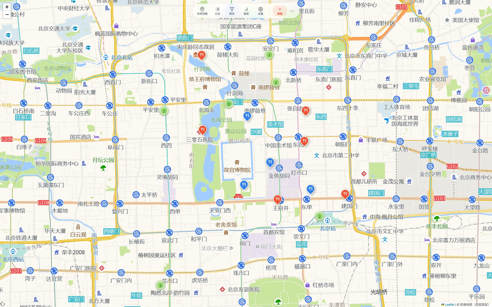
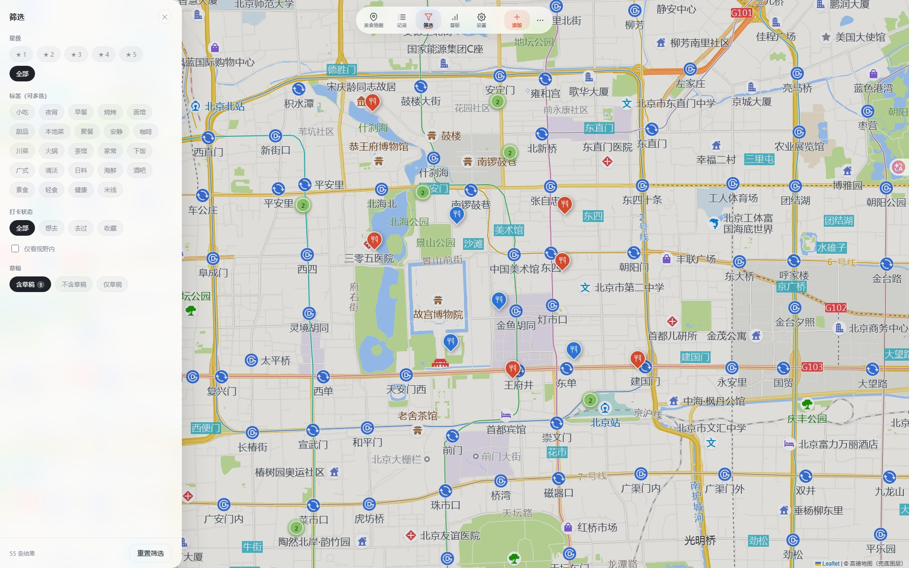
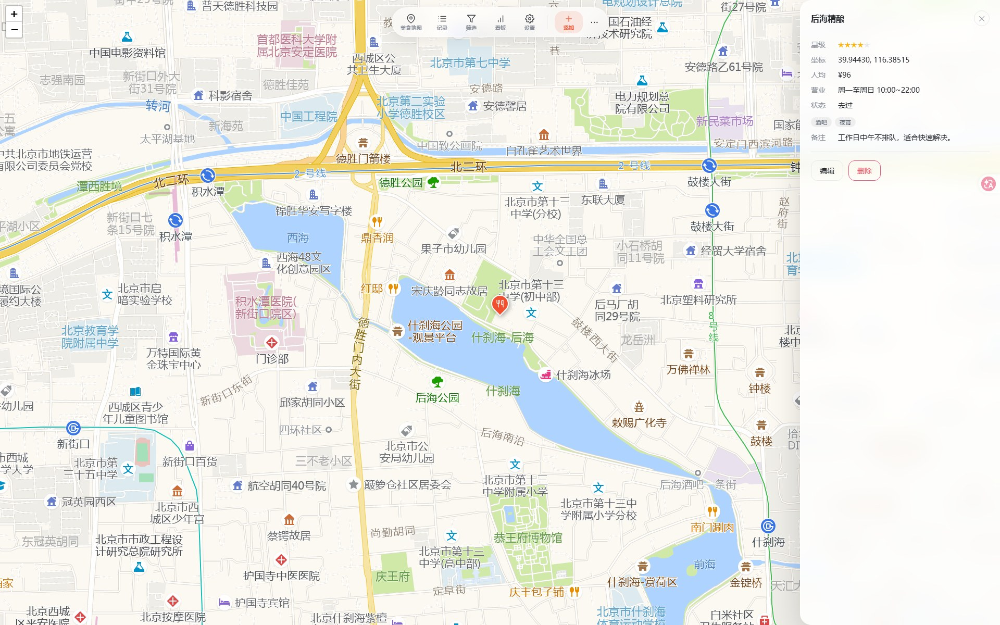

<div align="center">

# 🍜 Foodie Trail · 美食地图
### 每一顿值得记住的饭，都在一张图上

> 本地优先的个人美食记录：地图打点、评分、按价位 / 标签 / 状态筛选，用看板回看自己的口味 · FastAPI + Vue 3

[](./README.md)


</div>

---

> 📘 **本文档为中文。** 想看英文？→ **[Read in English →](./README.md)**

## 📸 界面预览

<table>
  <tr>
    <td align="center" width="50%">
      <a href="./docs/screenshots/01-map.jpg"></a>
      <br/><b>🗺 地图</b> · 按评分着色图钉、聚合、悬停预览
    </td>
    <td align="center" width="50%">
      <a href="./docs/screenshots/03-filter.jpg"></a>
      <br/><b>🔍 筛选</b> · 星级、价位档、标签、状态、草稿、视野
    </td>
  </tr>
  <tr>
    <td align="center" width="50%">
      <a href="./docs/screenshots/04-dashboard.jpg"></a>
      <br/><b>📊 看板</b> · 总量、评分 / 价位分布、近 12 个月趋势
    </td>
    <td align="center" width="50%">
      <a href="./docs/screenshots/05-detail.jpg"></a>
      <br/><b>🍽 详情</b> · 一键切状态、照片、编辑、导航
    </td>
  </tr>
</table>

> 🔎 **小提示**：看板里每张图都能点，点了会带着对应条件跳到清单。

---

## ✨ 特性一览

- 🗺 **地图优先的记录方式** —— 点地图落点、右键 / 长按直接带坐标新增、地址联想搜索；「定位我」用浏览器定位。
- 🏷 **字段齐全** —— 名称、1–5 星、标签、按周排班营业时间（一天多时段）、人均、打卡状态（想去 / 去过 / 收藏）、备注、最多 9 张照片。
- 🔍 **精确筛选** —— 关键词、精确星级区间、价位档（`<30 / 30–60 / 60–100 / 100–200 / ≥200`）、标签（全部 / 任一）、打卡状态、当前视野、草稿范围。筛选条件写进 URL，刷新和前进后退都不丢。
- 📋 **能扛住长列表** —— 滚动加载（每次渲染 60 条）、排序（最近更新 / 评分最高 / 人均最低 / 店名）、`↑`/`↓` + `Enter` 键盘操作、多选（全选 / 反选 / 清空）、批量删除。
- 📊 **数据看板** —— 总量、打卡率、待拔草、人均均值与中位数、评分与价位分布、高频标签、近 12 个月录入趋势、数据健康度，以及「接下来吃什么」清单；每张图都能下钻。
- 🖼 **照片** —— 自动校正 EXIF 方向，长边压到 1280 px 重编码 JPEG（目标 ≤ 500 KB），详情页支持灯箱与方向键翻页。
- 📝 **草稿** —— 没填完可以先存草稿（列表带角标、可单独筛）；新增表单还会自动存到 `localStorage`，误关不丢。
- 💾 **备份与恢复** —— JSON 导出（可含照片）→ 导入走 **预览 → 确认**，有实时进度，单条事务。
- 🔄 **更新过程看得见** —— 查 GitHub 有无新版本、带真实进度条下载（随时可取消）、点安装后换成三步进度界面（关掉应用 → 安装 → 重新启动）并自动刷成新版本；每次打开有约 1 秒开屏动画，刚更新完会直接写「**已更新到 vX**」。
- 🎨 **浅色 / 深色主题**，快捷键 `n` 新建、`/` 搜索、`f` 筛选、`Esc` 逐层返回。
- 🔒 **只在本机** —— 只监听 `127.0.0.1`、拒绝跨站来源，高德 Key 用 Fernet 加密存库。

> 💡 日常操作（新增记录、排班编辑器、导入流程、快捷键）见 **[使用指南（中文）](./docs/USAGE_zh.md)** · **[Usage Guide](./docs/USAGE.md)**。

---

## 🚀 本地从零启动

```bash
git clone https://github.com/perry466/foodie-trail.git
cd foodie-trail

# Windows
setup.bat          # 建 venv + 装运行与测试依赖
start.bat          # 启动并自动打开浏览器

# macOS / Linux
./setup.sh
./start.sh
```

就这些——**不需要 Node.js、不需要构建、不需要数据库服务**。前端是原生 ES 模块 + 本地 Vue 3，数据库是嵌入式 SQLite。

> ⚠️ 必须在**项目根目录**用 `python -m app.main` 启动：后端用的是包内相对导入，`python app/main.py` 会失败。

---

---

## 📦 Windows 安装版（不需要 Python）

上面的源码部署方式完全保留，两种方式并存。只想直接用的话，去
**[Releases](https://github.com/perry466/foodie-trail/releases)** 下载：

| 文件 | 是什么 |
| --- | --- |
| `FoodieTrail-x.y.z-windows-x64-setup.exe` | 安装包：装到当前用户目录，自动建桌面 / 开始菜单快捷方式，带卸载项 |
| `FoodieTrail-x.y.z-windows-x64.zip` | 绿色版：解压到任意目录，双击 `FoodieTrail.exe` 即用 |

两者是同一份构建产物。**都不会弹黑窗口**：启动后自动打开浏览器，并在右下角托盘常驻
（右键：打开 / 打开数据目录 / 退出）。关掉浏览器不会停服务。

- 数据在 **exe 同级的 `data/`** 里——备份、换机器就是复制这个目录。
- 卸载器**故意不删 `data/`**；要彻底清空请手动删除该目录。
- 升级：安装版直接覆盖安装；绿色版替换 `FoodieTrail.exe` + `_internal/` 即可，`data/` 不受影响。

### 自己打包

```bash
pip install -r requirements.txt -r requirements-build.txt
pyinstaller FoodieTrail.spec --noconfirm      # → dist/FoodieTrail/
python scripts/smoke_packaged.py              # 验证 exe 能启动、数据确实持久化

# 可选：生成安装包（需要 Inno Setup 6）
iscc installer\FoodieTrail.iss /DMyAppVersion=1.0.0
python scripts/make_release_zip.py 1.0.0
```

推一个 `v*` 标签，CI 会自动跑完上面全部步骤并把两个产物挂到 Release
（`.github/workflows/release.yml`）。本地产生的 `build/`、`dist/`、`release/`、
`installer/Output/`、`*.exe`、`*.zip` 全在 `.gitignore` 里，不会进仓库。

## 📑 目录

- [📋 一、环境要求](#一环境要求)
- [📁 二、项目结构](#二项目结构)
- [🚀 三、启动方式](#三启动方式)
- [🗺 四、地图与高德 Key](#四地图与高德-key)
- [💾 五、数据、备份与恢复](#五数据备份与恢复)
- [🧪 六、测试与数据体检](#六测试与数据体检)
- [💽 七、数据模型](#七数据模型)
- [🔌 八、接口一览](#八接口一览)
- [⚙️ 九、上限与默认值](#九上限与默认值)
- [❓ 十、常见问题](#十常见问题)
- [🛠 十一、开发指引](#十一开发指引)

---

## 📋 一、环境要求

| 依赖 | 版本 | 说明 |
| --- | --- | --- |
| Python | 3.10+ | 已在 3.14 上验证；`setup.bat` / `setup.sh` 会自动建 venv |
| Node.js | 18+ | **可选**，只有跑 `tests/front-check.js` 时需要 |
| Git | 任意 | 拉取与更新代码 |
| 浏览器 | 现代浏览器 | Chrome / Edge / Firefox / Safari |

不需要任何外部服务。没配高德 Key 时底图走高德公开栅格瓦片，其余功能全部本地运行。

---

## 📁 二、项目结构

```
foodie-trail/
├── app/                        # FastAPI 后端
│   ├── main.py                 # 路由、请求模型、图片处理、高德代理
│   ├── repository.py           # 数据访问 + 看板聚合 + 排序白名单
│   ├── validate.py             # 字段归一化与导入校验（读写共用）
│   ├── db.py                   # 建表、连接（WAL、外键）
│   ├── crypto.py               # 高德 Key 的 Fernet 加密（坏钥匙自愈）
│   ├── coords.py               # WGS-84 ↔ GCJ-02、球面距离
│   └── pathconf.py             # 路径、端口探测、照片参数
├── static/                     # 前端（无需构建）
│   ├── index.html              # 页面骨架 + 全部模板
│   ├── css/style.css           # 样式（浅色 / 深色）
│   ├── js/app.js               # 地图适配层 + 界面逻辑
│   └── lib/                    # 本地 Vue、Leaflet、markercluster
├── docs/
│   ├── screenshots/            # README 用的截图
│   ├── USAGE.md                # 使用指南（英文）
│   └── USAGE_zh.md             # 使用指南（中文）
├── tests/                      # pytest 用例 + Node 前端断言
├── hooks/pre-commit            # 可选的提交前守卫（拦数据文件）
├── launcher.py                 # 打包入口：托盘、单实例、日志落盘
├── FoodieTrail.spec            # PyInstaller 配置（onedir、无控制台）
├── requirements-build.txt      # 仅打包用的依赖（pyinstaller、pystray）
├── assets/icon.ico             # 应用与托盘图标
├── installer/FoodieTrail.iss   # Inno Setup 脚本 → Windows 安装包
├── packaging/快速开始.txt       # 随包分发的快速开始
├── scripts/                    # make_release_zip.py、smoke_packaged.py、release_notes.py
├── .github/workflows/release.yml  # 打 tag → 构建 exe + 安装包 → 发布 Release
├── CHANGELOG.md                # 各版本变更；同时是 Release 正文的来源
├── health_check.py             # 只读数据体检
├── repo_guard.py               # 守卫规则（默认放行）
├── seed_demo.py                # 演示数据（直写库，`demo-` 前缀，可清）
├── seed_1000.py                # 批量演示数据（走运行中的 API）
├── setup.bat / setup.sh        # 建 venv + 装依赖
├── start.bat / start.sh        # 探测解释器后启动
├── data/                       # ← 你的数据（不进版本库）
└── README.md / README_zh.md
```

---

## 🚀 三、启动方式

### 3.1 一键脚本（推荐）

| 平台 | 首次 | 以后每次 |
| --- | --- | --- |
| Windows | `setup.bat` | `start.bat` |
| macOS / Linux | `./setup.sh` | `./start.sh` |

- `setup` 建 `venv/` 并安装 `requirements.txt` + `requirements-dev.txt`。
- `start` 会先验证解释器能不能真的 `import fastapi, uvicorn, PIL`；venv 坏了自动回退 `py -3` / `python`；都不行时打印修复指引，而不是抛一屏堆栈。

启动时应用会：

1. 在 `20000–65535` 里挑一个空闲端口（优先复用 `data/.last_port` 里上次的端口）；
2. 初始化数据库与 `data/photos/`；
3. 约 1.5 秒后自动打开 `http://127.0.0.1:<端口>`。

### 3.2 手动方式

```bash
python -m venv venv
# Windows: venv\Scripts\activate    macOS/Linux: source venv/bin/activate
pip install -r requirements.txt -r requirements-dev.txt
python -m app.main
```

### 3.3 端口与数据位置

| 环境变量 | 默认 | 作用 |
| --- | --- | --- |
| `PORT` | `20000–65535` 随机空闲端口 | 指定端口；非法值只提示并自动选端口，不会崩 |
| `FOODMAP_DATA_DIR` | `<仓库>/data` | 整个数据目录搬家（便携使用、测试、多套数据） |

```bash
# 起第二个互不干扰的实例
FOODMAP_DATA_DIR=/tmp/foodie-demo PORT=31200 python -m app.main
```

---

## 🗺 四、地图与高德 Key

| 配置 | 底图 | 地址搜索 | 路线 |
| --- | --- | --- | --- |
| 不配 Key | Leaflet + 高德栅格瓦片 | ✗（界面有提示条说明） | ✗ |
| JS API Key + 安全密钥 | 高德 JS API 2.0 | ✗ | ✗ |
| 再加 Web 服务 Key | 高德 JS API 2.0 | ✓ POI 联想、地址解析 | ✓ 驾车路线 |

Key 在应用内的「设置」里填，**不写进源码**。

- 加密后存进 `data/foodmap.db`，加密钥匙是 `data/.fernet.key`。
- 已保存的值以掩码回显（`••••1234`）；输入框留空表示**保持原值**，要删必须走明确的「清除」操作。
- `data/.fernet.key` 万一损坏，启动时会自动把它改名留档、生成新钥匙继续跑——只有此前保存的高德 Key 需要重填，记录和照片不受影响。

---

## 💾 五、数据、备份与恢复

所有东西都在 `data/`：

```
data/
├── foodmap.db        # SQLite（WAL）—— 记录、照片行、设置
├── foodmap.db-wal    # 预写日志（自动合并）
├── photos/           # 每张照片一个 JPEG
├── .fernet.key       # 加密高德凭据的钥匙
├── .last_port        # 上次使用的端口
└── backups/          # 可选手工快照
```

**导出**（更多 → 导出备份）会得到一个 JSON：

| 模式 | 内容 | 用途 |
| --- | --- | --- |
| `full` | 记录 **+ base64 照片** | 真正的备份、换机器 |
| `meta` | 只有记录，`photosIncluded: false` | 快速导出数据，导入时不动照片 |

默认包含草稿，且当前筛选条件仍然生效——想导全部，先清掉搜索与筛选。

**导入**刻意做得谨慎：

1. **预览** —— 只统计会新增 / 覆盖 / 无效多少条，不写库；
2. **确认** —— 才开始写入，并显示进度；
3. 每条记录一个事务；照片先解码、校验、重编码，全部通过了才动数据库；
4. 某条记录里有一张照片坏了 → 这条**保留原有照片**，不会先删后写；
5. `updatedAt` 不比本地新的记录会跳过，并单独报出**「已是最新未覆盖」**的条数。

**换机器**：复制整个 `data/` 目录。只拷 `foodmap.db` 会丢 `.fernet.key`，已存的高德 Key 解不开（记录本身没事）。

**清理演示数据**：`python seed_demo.py --clear --yes` 只删 `demo-` 前缀的记录及其照片文件，真实记录一条不动。

---

## 🧪 六、测试与数据体检

```bash
python -m pytest tests -q      # 后端 211 例
node tests/front-check.js      # 前端 48 项断言（Node 18+）
tests\run-tests.bat            # 两条一起跑，退出码 0 / 1 / 2（2 = 缺 Node）
```

覆盖重点：CRUD 与校验、照片上传 / 读取 / 删除、导出 → 清库 → 导入往返（含照片字节）、损坏备份的安全性、草稿口径、加密 Key 语义、七天排班往返、导入性能、启动健壮性（坏 `.fernet.key`、非法 `PORT`），以及提交守卫。

**数据体检**（只读，不改任何东西）：

```bash
python health_check.py          # 完整性、表结构、计数、字段越界、照片、演示数据
python health_check.py --deep   # 额外逐张解码验证 JPEG
```

**提交守卫** —— `data/` 已被 `.gitignore` 挡掉，钩子再加一道：

```bash
# 每个 clone 装一次
cat hooks/pre-commit > .git/hooks/pre-commit && chmod +x .git/hooks/pre-commit
```

它会拦下暂存区里的 `data/`、`*.db`、`*.key`/`*.pem`、`.env*`、备份 JSON、`.tmp-*`、`venv/`、`dist/*.exe`，并列出具体文件名；源码、测试、文档、截图一律放行。守卫**自己**出错时会放行并提示，不会把你锁死在提交这一步。

---

## 💽 七、数据模型

| 表 | 字段 | 类型 | 说明 |
| --- | --- | --- | --- |
| `records` | `id` | TEXT PK | `[A-Za-z0-9_-]{1,64}`，未指定则生成 uuid4 |
| | `name` | TEXT | 必填，≤ 120 字 |
| | `lng` / `lat` | REAL | 必填，按 WGS-84 校验范围 |
| | `rating` | INTEGER | 1–5 |
| | `tags` | TEXT | JSON 数组，≤ 32 个 × 24 字 |
| | `business_hours` | TEXT | 按周排班 JSON `{"mon":[{"s":"10:00","e":"22:00"}],…}`，或旧的纯文本 |
| | `avg_price` | INTEGER | 0–100000，`0` 是有效价格（免费） |
| | `checkin_status` | TEXT | `want` / `visited` / `favorite` / NULL |
| | `note` | TEXT | ≤ 2000 字 |
| | `draft` | INTEGER | 0 / 1 |
| | `created_at` / `updated_at` | INTEGER | 毫秒时间戳，限定 2000–2100 |
| `photos` | `id`、`record_id`、`path`、`thumb`、`created_at` | | `record_id` 随记录级联删除；`path` 形如 `photos/<uuid>.jpg` |
| `settings` | `key`、`value` | TEXT | 存加密后的高德凭据 |
| `meta` | `key`、`value` | TEXT | 结构版本 |

---

## 🔌 八、接口一览

全部在 `127.0.0.1` 的 `/api` 下；来自其它站点的请求一律 `403`。

| 方法 | 路径 | 说明 |
| --- | --- | --- |
| GET | `/api/records` | 列表，支持 `keyword`、`ratingMin/Max`、`avgPriceMin/Max`、`checkinStatus`、`tags`、`tagsAny`、`includeDrafts`、`draftsOnly`、`swLng/swLat/neLng/neLat`、`sort`、`limit`、`offset` |
| GET | `/api/records/{id}` | 单条（**含照片**） |
| POST | `/api/records` | 新建（`201`；id 已存在返回 `409`） |
| PUT | `/api/records/{id}` | **全量替换**——没传的可选字段会被重置（见下方提醒） |
| DELETE | `/api/records/{id}` | 删除记录；先删库行、提交成功后再删照片文件 |
| DELETE | `/api/records/batch` | body `{"ids": [...]}`，单事务删行，再清文件 |
| POST | `/api/records/{id}/photos` | 上传一张图（multipart `file`），每条最多 9 张 |
| GET | `/api/photos/{id}` | 原始 JPEG |
| DELETE | `/api/photos/{id}` | 先删照片行，再删文件 |
| GET | `/api/config/amap` | 有哪些 Key（`configured` / `webConfigured`），绝不返回明文 |
| PUT | `/api/settings/amap` | 保存 JS Key / 安全密钥 / Web 服务 Key（空值 = 保持原值） |
| DELETE | `/api/settings/amap/security` | 只清安全密钥 |
| DELETE | `/api/settings/amap` | 清空全部高德 Key |
| POST | `/api/settings/test-connection` | 用已存的 Key 向高德验证 |
| GET | `/api/amap/poi` | POI 联想（`keywords`，可选 `city`、`location`） |
| GET | `/api/amap/geocode` | 地址 → 坐标 |
| GET | `/api/amap/route` | 两点驾车路线 |
| POST | `/api/coords/convert` | 浏览器定位的 WGS-84 → GCJ-02 |
| GET | `/api/recommend/nearby` | 附近记录（仅接口，界面未用） |
| GET | `/api/recommend/similar/{id}` | 相似记录（按标签 / 价位，仅接口） |
| GET | `/api/dashboard` | 看板聚合统计（不含草稿） |
| GET | `/api/export` | 流式导出 JSON：`mode=full\|meta`、`includeDrafts` |
| POST | `/api/import` | multipart `file`；`confirm=true` 写入，`progress=1` 走 NDJSON 进度流 |
| GET | `/api/app/version` | 本地版本号 + 运行形态（`source` / `portable` / `installer`） |
| GET | `/api/update/check` | 比对 GitHub 最新 Release 与本地版本；`force=1` 跳过 30 分钟缓存 |
| POST | `/api/update/download` | 后台下载安装包（仅安装版可用） |
| GET | `/api/update/download` | 下载进度（`state`、`percent`、`received`、`total`） |
| POST | `/api/update/cancel` | 取消正在进行的下载；幂等，返回同样的进度结构（`state` → `cancelling` → `cancelled`，`.part` 会被删掉） |
| POST | `/api/update/install` | 复核安装包（大小 + sha256）后启动安装程序并退出；返回 `{ok, willExit, version, delay}` 供前端标注安装界面 |
| POST | `/api/update/reveal` | 打开下载目录，供自动安装失败时手动双击安装包 |

> 🔄 **更新接口不会“大声失败”**：GitHub 连不上时 `/api/update/check` 仍返回 HTTP 200 与 `{"ok": false, "reason": "..."}`，界面只写一行灰字，绝不阻塞启动。只有安装版能自动安装；绿色版与源码版会被引导到 Release 页面手动下载——在那两种形态里静默跑 `setup.exe` 会**再装一份**，而不是升级当前这一份。

> ⚠️ **`PUT` 是全量替换。** 漏传的字段会被重置（`tags → []`、`note → null`、`avgPrice → null`、`checkinStatus → null`、`draft → false`）。界面每次都发完整字段；用脚本改状态时务必先 `GET`，改完再整体 `PUT`。

---

## ⚙️ 九、上限与默认值

| 项目 | 上限 |
| --- | --- |
| 单条记录照片数 | 9 张 |
| 上传文件 | 单张 ≤ 20 MB |
| 存库照片 | 长边 1280 px，JPEG 质量 82 → 最低降到 30，目标 ≤ 500 KB |
| 支持格式 | Pillow 能解码的都行（JPG / PNG / WebP / GIF / 8 位与 16 位灰度…） |
| 备份文件 | ≤ 256 MB，≤ 20 万条记录 |
| 备份内单张照片 | 解码后 ≤ 2 MB，像素 ≤ 6400 万 |
| 店名 / 备注 / 标签 | 120 字 / 2000 字 / 32 个 × 24 字 |
| 人均 | 0 – 100000（`0` = 免费） |
| 网络 | 只监听 `127.0.0.1`，按设计**不支持**局域网与手机访问 |

---

## ❓ 十、常见问题

**Q1：浏览器没自动打开 / 每次端口都不一样**
启动日志里有 URL，也会写进 `data/.last_port`。手动打开那个地址即可；想固定端口用 `PORT=31200 python -m app.main`。

**Q2：地图空白，但记录能正常加载**
底图瓦片需要联网。另外没配高德 Key 时会有提示条说明地址搜索与路线不可用——这是预期行为，图钉和筛选照常工作。

**Q3：地址搜索提示需要 Key**
搜索用的是 **Web 服务**类型的 Key（和 JS API Key 不是同一个）。到「设置 → Web 服务 Key」填上；只配 JS Key 只能出底图。

**Q4：照片传不上去**
先看格式（必须能被 Pillow 解码）和体积（≤ 20 MB）。超过 6400 万像素的全景图会被主动拒绝，防止解压炸弹。

**Q5：导入结果写着「写入 0 条」**
说明文件里每条记录都不比本地新，没有任何覆盖。结果里还会单独给出「已是最新未覆盖」的条数。

**Q6：导入后照片没了**
备份是 `meta` 模式导出的（`photosIncluded: false`），按设计不动已有照片。需要照片就用 `full` 模式重新导。

**Q7：换了机器 / 升级 Python 后起不来**
重跑 `setup.bat`（或 `./setup.sh`）重建 `venv`。`start.bat` 也会回退到系统解释器并告诉你缺什么。

**Q8：能用手机或另一台电脑打开吗？**
不能，这是刻意的：只监听 `127.0.0.1` 且拒绝跨站请求，数据不出本机。要在别的地方用，复制整个 `data/` 目录。

**Q9：想全部清空重来**
停掉应用，删掉 `data/`（或把 `FOODMAP_DATA_DIR` 指到一个新目录）再启动。删之前先备份。

**Q10：双击 exe 没反应**
这个程序没有黑窗口。等几秒看右下角托盘（右键 → 打开）；连托盘图标都没有的话，
去看 exe 同级的 `data/app.log`，启动失败的报错都记在里面。

**Q11：列表里有 100 条「演示」记录**
那是 `seed_demo.py` 生成的，id 都带 `demo-` 前缀。用 `python seed_demo.py --clear --yes` 删掉（会连带删除它们的照片）。

---

## 🛠 十一、开发指引

- **后端** —— `app/main.py` 放路由与请求模型；只有 `app/repository.py` 碰 SQL；`app/validate.py` 由写接口和导入共用。
- **前端** —— 没有打包器。改 `static/js/app.js` / `static/index.html` / `static/css/style.css` 刷新即可；Vue 在 `static/lib/vue`。
- **加一个筛选条件** —— `list_records()` 参数 → `repository.list()` → `app.js` 的 `_filterQuery()` / `_matchFilters()`；接口与本地预估的口径必须一致。
- **加一个字段** —— `RecordIn`（带 validator）→ `db.SCHEMA` + 迁移 → `repository` 读写 → 表单与详情模板 → 导出/导入 payload。
- **值得守住的不变量**（都有测试）：价位区间 `[下限, 上限)`；草稿在列表与地图只有一档口径；先删库行再删文件；导入照片两阶段替换；排序字段走白名单；`PUT` 是整体替换；照片路径存正斜杠。

提交前跑全套——提交钩子只拦数据，不保证代码正确：

```bash
tests\run-tests.bat      # Windows
python -m pytest tests -q && node tests/front-check.js
```

### 发版

版本号只在 `app/version.py` 一处。推 `v*` tag 会触发 CI 打包，tag 与 `VERSION` 不一致直接拒绝发布。

每个版本还必须带变更说明：**打 tag 之前**在 [CHANGELOG.md](CHANGELOG.md) 里加一个
`## [x.y.z]` 章节，`scripts/release_notes.py` 会把该章节抽成 Release 正文
（再补上通用的「下载哪个文件 / 怎么升级 / 怎么校验」尾巴）；章节缺失时构建直接失败。
分类沿用 Keep a Changelog：`新增 / 变更 / 修复 / 移除 / 安全性 / 破坏性变更`，空分类不写。

```bash
# 1) 改 app/version.py，2) 写 CHANGELOG 章节，3) commit，4) 打 tag
python scripts/release_notes.py 2.0.0 --print   # 本地先预览正文
git tag v2.0.0 && git push origin main v2.0.0
```

---

## 📄 许可

供个人学习与使用，仓库未附带开源许可证文件；如需对外分发请自行补充。
